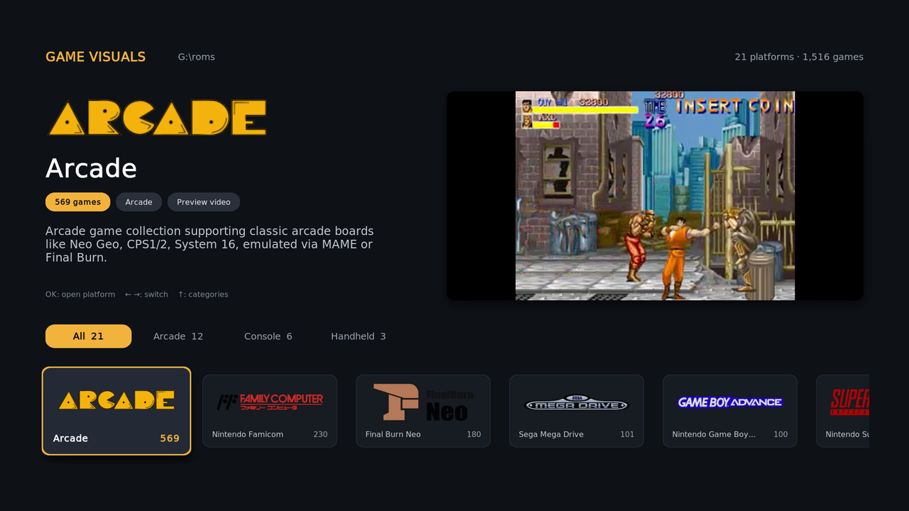

# Game Visuals (游戏画廊)

[中文文档](docs/README_zh.md)

A game visualization add-on for Kodi.

## Motivation

While using Kodi as a home entertainment center, I found that it lacked an add-on dedicated to browsing and showcasing game-related visual resources. Although Kodi natively supports various types of media, its management and presentation of game visuals are not very well-developed. Therefore, I decided to create this add-on to provide users with an intuitive and easy-to-use interface for browsing and displaying their game visuals, such as screenshots, titles, and descriptions.

## Features

* Supports direct use of RecalBox’s **gamelist.xml** file without extra configuration, see [here](docs/wiki/en/gamelist-usage.md) for more details.
* Provides a game details screen and four custom browse layouts with automatic trailer playback, see the [User Manual](docs/wiki/en/user-manual.md).
* A platform screen for multi-platform ROM folders: platform logos, game counts, category filters and random preview videos.
* Automatically detects games in ROM folders and displays the corresponding visual resources, skipping BIOS files, disc track files and non-game folders.
* Marks CPS3 games that cannot run without their CD image.
* Choose a browse layout in the add-on settings: four custom layouts (the default is A: Classic two-column), or the Kodi default list, which keeps Kodi's own view types.

## Known Issues

- ~~**Preview Videos:** Cannot be played due to limitations in Kodi’s layout files, which do not provide a dedicated area for video previews.~~ Use a custom browse layout or the game details screen to play trailers.

- ~~**ZIP SNES ROMs:** SNES ROMs compressed in .zip format cannot be launched directly. Kodi’s built-in RetroPlayer treats zipped ROMs as arcade ROMs, so they must be extracted before use.~~

## License

This project is licensed under the MIT License - see the [LICENSE](LICENSE.txt) file for details.

The platform logos `cave.png`, `pgm.png`, `pgm2.png` and `psikyo.png` in `resources/logos` are converted from the [Crystal](https://github.com/dm2912/Crystal) EmulationStation theme by dm2912, and are used under its attribution / non-commercial terms. They are not covered by the MIT License.

## Support
If you find this add-on useful and would like to support its development, please consider making a donation. Your support is greatly appreciated!

If you encounter any issues or have suggestions for improvement, please feel free to open an issue on the [GitHub repository](https://github.com/yunnysunny/game-visuals).

## TODO
- [x] Add support for multiple root path for roms.
- [x] Improve compatibility with zipped ROMs.
- [ ] Add support for default ROM base path.
- [ ] Add support for custom information panel.

